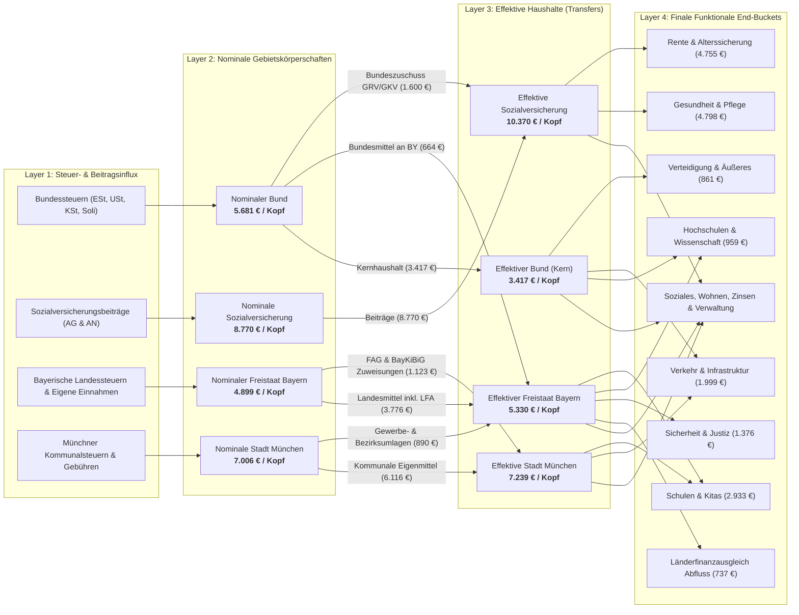

# Fiscal Per-Capita Breakdown: Bund, Freistaat Bayern & Landeshauptstadt München

[](.agents/skills/responsible-research/scripts/audit_research_pipeline.py)
[](datasets/fiscal_sankey_flows_per_capita.csv)
[](plots/sankey_fiscal_per_capita.png)
[](plots/sankey_fiscal_interactive.html)

This repository provides an empirical, publication-grade fiscal analysis decomposing public money in Germany for an individual resident of the **City of Munich (*Landeshauptstadt München*)** in 2024 (with longitudinal comparison to 2023). Every resident of Munich simultaneously receives public goods and services financed across four distinct public tiers:
1. **Federal Republic of Germany (*Bund*)**
2. **Statutory Social Insurances (*Sozialversicherungsträger*: GRV, GKV, SPV, BA, DGUV)**
3. **Free State of Bavaria (*Freistaat Bayern*)**
4. **City of Munich (*Landeshauptstadt München*)**

The flagship analytical visualization is a **4-Layer High-Resolution Sankey Diagram** ([plots/sankey_fiscal_per_capita.png](plots/sankey_fiscal_per_capita.png) and [plots/sankey_fiscal_interactive.html](plots/sankey_fiscal_interactive.html)), built using official audited administrative budget records from the Federal Ministry of Finance (BMF), the Federal Statistical Office (Destatis), the Bavarian State Ministry of Finance and Homeland (StMFH), and the Munich Municipal Treasury (*Stadtkämmerei München*).

---

## 1. The 4-Layer Fiscal Sankey Diagram

The Sankey diagram tracks the complete lifecycle of public funds—from primary tax and contribution origin, through gross jurisdictional appropriation and vertical/horizontal intergovernmental transfers, into final citizen-facing functional areas.



---

## 2. Layer Taxonomy & Flow Semantics

### Layer 1: Steuer- & Beitragsinflux (Revenue Stream Influx)
Every influx node shares the color of its respective Layer 2 nominal entity and is vertically clustered directly adjacent to it:
- **Federal Taxes (Navy `#1e3a8a`)**: Lohn- und Einkommensteuer, Umsatz- & Einfuhrumsatzsteuer, Körperschaftsteuer, Energiesteuer, Tabaksteuer, Solidaritätszuschlag und Bundeskredite.
- **Social Insurance Contributions (Teal `#0d9488`)**: Pure employer and employee payroll contributions to Pension (GRV), Health (GKV), Long-Term Care (SPV), Unemployment (BA), and Occupational Accident (DGUV) insurance.
- **Bavarian Own Revenues (Bavarian Sky Blue `#0284c7`)**: Share of shared joint taxes (*Gemeinschaftsteuern*), dedicated state taxes (inheritance, real estate transfer, beer tax), and administrative revenues. Federal grants (*Bundesmittel*) are routed via the Federal tier.
- **Munich Municipal Revenues (Munich Amber `#d97706`)**: Trade tax (*Gewerbesteuer netto*), municipal share of income and VAT, property tax (*Grundsteuer A/B*), and municipal fees/tariffs.

### Layer 2: Nominale Gebietskörperschaften (Gross Inflow Entities)
Represents the gross budgetary volume appropriated by each tier prior to intergovernmental equalizations:
- **Nominaler Bund**: **5.680,98 € / resident** (€474,80 bn)
- **Nominale Sozialversicherung**: **8.769,98 € / resident** (€732,97 bn pure contributions)
- **Nominaler Freistaat Bayern**: **4.898,51 € / resident** (€64,90 bn own revenues)
- **Nominale Stadt München**: **7.005,95 € / resident** (€10,544 bn)

> [!IMPORTANT]
> **Strict Layer 2 Isolation**: Nodes in Layer 2 connect **exclusively to Layer 3**. All nominal gross revenues must either pass into core retention or be transferred to another tier. No nominal link bypasses Layer 3.

### Intergovernmental Transfers (Layer 2 $\to$ Layer 3)
Between Layer 2 and Layer 3, the vertical and horizontal fiscal transfers of German federalism are made explicit:
1. **Federal Subsidies to Social Insurances (*Bundeszuschüsse*)**:
   - Bund $\to$ Rentenversicherung: **1.399,90 € / resident** (€117,00 bn)
   - Bund $\to$ Gesundheitsfonds: **199,82 € / resident** (€16,70 bn)
   - *Total*: **1.599,72 € / resident** (€133,70 bn tax-financed subsidy styled in vibrant purple `rgba(139, 92, 246, 0.85)`).
2. **Federal Grants to Free State of Bavaria (*Bundeszuweisungen*)**:
   - Bund $\to$ Freistaat Bayern: **664,20 € / resident** (€8,80 bn federal co-funding for transport, education, and administration).
3. **What Flows from Munich to the State & District (*Umlagen*)**:
   - München $\to$ Freistaat Bayern: **890,36 € / resident** (€1,34 bn total: Gewerbesteuerumlage €0,41 bn + Bezirksumlage an den Bezirk Oberbayern €0,93 bn for integration and psychiatric welfare).
4. **What Flows from the State to Munich (*Kommunaler Finanzausgleich & Zuweisungen*)**:
   - Freistaat Bayern $\to$ München: **1.122,92 € / resident** (€1,69 bn total: FAG municipal key grants Art. 10 FAG + BayKiBiG childcare operational subsidies).
5. **State Retention of Equalization Liabilities**:
   - Freistaat Bayern retains **3.775,59 € / resident**, which funds both internal state ministries and the state's outward equalization liabilities.

### Layer 3: Effektive Haushalte (Net Effective Budgets)
The net disposable funds available to each public entity following intergovernmental consolidation:
- **Effektiver Bund (Kern)**: **3.417,06 € / resident** (€285,60 bn)
- **Effektive Sozialversicherung**: **10.369,70 € / resident** (€866,67 bn including federal subsidies)
- **Effektive Stadt München**: **7.238,51 € / resident** (6.115,59 € retained local + 1.122,92 € state grants)
- **Effektiver Freistaat Bayern**: **5.330,15 € / resident** (3.775,59 € own funds + 664,20 € federal grants + 890,36 € Munich transfers)

### Layer 4: Finale Funktionale End-Buckets (Citizen-Facing Outlays)
Final destination categories providing direct public utility:
- **Rente & Alterssicherung**: **4.754,89 € / resident** (€397,40 bn)
- **Gesundheit & Pflege**: **4.798,00 € / resident** (€401,00 bn statutory health, care, and clinic subsidies)
- **Schulen & Kitas**: **2.933,29 € / resident** (Bayern Kultus 1.197 € + München RBS 1.736 €)
- **Hochschulen & Wissenschaft**: **959,19 € / resident** (Bayern Universitäten 702 € + Bund Forschung 257 €)
- **Verteidigung & Äußeres**: **860,88 € / resident** (€71,95 bn regular defense, Sondervermögen Bundeswehr, and diplomacy)
- **Verkehr & Infrastruktur**: **1.999,93 € / resident** (Bund 534 € + Bayern 476 € + München MVG/Straßen 990 €)
- **Sicherheit & Justiz**: **1.375,50 € / resident** (Bayern Polizei/Justiz 870 € + München KVR/Feuerwehr 346 € + Bund 160 €)
- **Länderfinanzausgleich (End-Bucket)**: **737,42 € / resident** (€9,77 bn net outflow paid by Bavaria to financially weaker states)
- **Soziales, Wohnen, Arbeitsförderung, Zinsen & Verwaltung**: remaining statutory outlays.

> [!NOTE]
> **Mathematical Verification**: By Kirchhoff's law, every node in Layer 1, 2, 3, and 4 satisfies exact flow conservation:
> $$\sum \text{Inflow}_n \equiv \sum \text{Outflow}_n \quad (\Delta < 0{,}01\text{ € / resident})$$

---

## 3. Data Provenance & Cryptographic Verification

All primary data tables reside in [`rawdata/`](rawdata/) and are cryptographically verified against SHA-256 checksums in [`rawdata/MANIFEST.csv`](rawdata/MANIFEST.csv):

| Register Table | Time Span | Originating Institution | Primary Record Source |
| :--- | :--- | :--- | :--- |
| `destatis_bundeshaushalt_2023_2024.csv` | 2023–2024 | Bundesministerium der Finanzen (BMF) | Bundeshaushaltsrechnung & Haushaltsgesetz |
| `destatis_sozialversicherung_2023_2024.csv` | 2023–2024 | Bundesministerium für Arbeit und Soziales / Destatis | Sozialbudget & Destatis Fachserie 14 Reihe 4 |
| `bayern_staatshaushalt_2023_2024.csv` | 2023–2024 | Bayerisches Staatsministerium der Finanzen (StMFH) | Haushaltsrechnung Freistaat Bayern Epl 01–20 |
| `muenchen_haushalt_2023_2024.csv` | 2023–2024 | Landeshauptstadt München Stadtkämmerei | Jahresabschluss & Haushaltsplan München |
| `demographics_zensus_denominators_2023_2024.csv` | 2023–2024 | Bayerisches Landesamt für Statistik / Destatis | Zensus 2022 Stichtag 15. Mai 2022 fortgeschrieben |

### Demographic Denominators (Zensus 2022 Tier 1 Baseline)
Normalizations use official post-censal populations (*Amtliche Einwohnerzahl fortgeschrieben auf Basis Zensus 2022*):
- **Deutschland**: $83.577.140$ residents (2024) / $83.456.045$ residents (2023)
- **Freistaat Bayern**: $13.248.928$ residents (2024) / $13.176.426$ residents (2023)
- **Landeshauptstadt München**: $1.505.005$ residents (2024) / $1.488.719$ residents (2023)

---

## 4. Quickstart & Pipeline Reproduction

### Prerequisites
- Python 3.9+
- macOS / Linux / Windows

### Setup Environment
```bash
# 1. Clone repository
git clone https://github.com/selle/DE-fiscal-per-capita.git
cd DE-fiscal-per-capita

# 2. Initialize virtual environment and install dependencies
python3 -m venv .venv
source .venv/bin/activate
pip install -r requirements.txt
```

### Execute Data Pipeline & Rendering
```bash
# 3. Process raw administrative tables and generate audited flows
python3 src/data_preparation.py

# 4. Render high-resolution Sankey PNG, interactive HTML, and synoptic matrix
python3 src/modeling.py

# 5. Run the automated 5-stage research pipeline audit
python3 .agents/skills/responsible-research/scripts/audit_research_pipeline.py
```

Expected audit output:
```
======================================================================
RESPONSIBLE RESEARCH: GENERAL PIPELINE AUDIT SUITE
======================================================================
[Check 1] Validating Repository Directory Structure & Lockfiles...   ✓ PASSED
[Check 2] Validating Rawdata Manifest & Cryptographic SHA-256...     ✓ PASSED
[Check 3] Validating Active Datasets in datasets/...                 ✓ PASSED
[Check 4] Running Strict AST Static Code Analysis on src/*.py...     ✓ PASSED
[Check 5] Verifying Plot Validity Documentation in plots/plot.md...  ✓ PASSED
======================================================================
PIPELINE AUDIT COMPLETE: 5/5 CHECKS PASSED.
======================================================================
```

---

## 5. Repository Structure

```
DE-fiscal-per-capita/
├── README.md                                      # Central repository documentation (this file)
├── requirements.txt                               # Pinned dependencies (plotly, kaleido, pandas, etc.)
├── rawdata/                                       # Immutable primary source registers
│   ├── MANIFEST.csv                               # Cryptographic SHA-256 registry
│   ├── rawdata.md                                 # Provenance descriptions & register citations
│   ├── destatis_bundeshaushalt_2023_2024.csv
│   ├── destatis_sozialversicherung_2023_2024.csv
│   ├── bayern_staatshaushalt_2023_2024.csv
│   ├── muenchen_haushalt_2023_2024.csv
│   └── demographics_zensus_denominators_2023_2024.csv
├── datasets/                                      # Audited analysis-ready datasets
│   ├── datasets.md                                # Variable codebook and mathematical definitions
│   ├── fiscal_sankey_flows_per_capita.csv         # 106 directed graph edges with €/Kopf & € bn
│   ├── fiscal_per_capita_summary.csv              # Headline comparative summary across tiers
│   └── literature_empirical_benchmarks.csv        # Verbatim literature citations and benchmark catalog
├── plots/                                         # Publication figures & visual artifacts
│   ├── plot.md                                    # Systematic methodological plot documentation
│   ├── sankey_fiscal_per_capita.png               # High-res static Sankey (4800x2700 px, 2.2 MB)
│   ├── sankey_fiscal_interactive.html             # Interactive Plotly web widget
│   ├── synoptic_3x3_matrix.png                    # 9-panel executive research matrix
│   └── panel_a_per_capita_breakdown.png ...       # Individual research panels A through I
├── src/                                           # Audited pipeline source code (AST compliant)
│   ├── data_preparation.py                        # Raw-to-dataset normalization & flow builder
│   └── modeling.py                                # Plotly/Kaleido rendering engine
└── literature/                                    # Academic and administrative citations catalog
    ├── literature.md
    └── citations.md
```

---

## 6. Citation & Legal Notice

Primary administrative data are public sector information (*Amtliche Werke*) under § 5 UrhG (Germany). All rights reserved for repository synthesis, modeling architectures, and visualization assets.

If you reference this model or visualization in research, policy analysis, or journalism, please cite:

```bibtex
@misc{fiscal_per_capita_munich_2024,
  author       = {Selle, Antigravity Empirical Research Team},
  title        = {4-Layer Fiscal Per-Capita Breakdown: Bund, Freistaat Bayern & Landeshauptstadt München},
  year         = {2024},
  publisher    = {GitHub},
  howpublished = {\url{https://github.com/selle/DE-fiscal-per-capita}}
}
```

