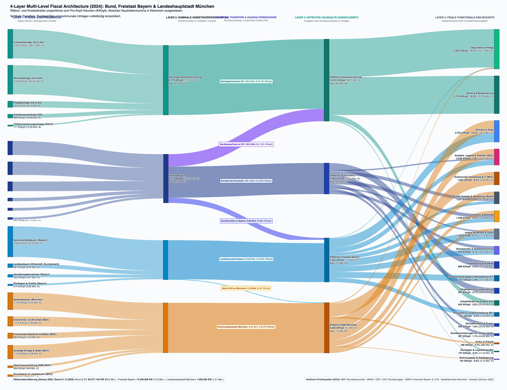
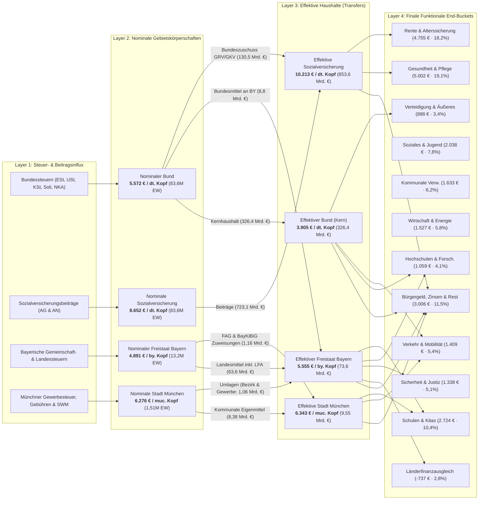

# Fiscal Per-Capita Breakdown: Bund, Freistaat Bayern & Landeshauptstadt München

[](.agents/skills/responsible-research/scripts/audit_research_pipeline.py)
[](datasets/fiscal_sankey_flows_per_capita.csv)
[](plots/sankey_fiscal_per_capita.png)
[](plots/sankey_fiscal_interactive.html)

This repository provides an empirical, publication-grade fiscal analysis decomposing public money in Germany for an individual resident of the **City of Munich (*Landeshauptstadt München*)** in 2024 (with longitudinal comparison to 2023). Every resident of Munich simultaneously receives public goods and services financed across four distinct public tiers:
1. **Federal Republic of Germany (*Bund*)**
2. **Statutory Social Insurances (*Sozialversicherungsträger*: GRV, GKV, SPV, BA, DGUV)**
3. **Free State of Bavaria (*Freistaat Bayern*)**
4. **City of Munich (*Landeshauptstadt München*)**

The flagship analytical visualization is a **4-Layer High-Resolution Sankey Diagram** ([plots/sankey_fiscal_per_capita.png](plots/sankey_fiscal_per_capita.png) and [plots/sankey_fiscal_interactive.html](plots/sankey_fiscal_interactive.html)), built using verified primary source documents from the Federal Ministry of Finance (BMF), the Federal Statistical Office (Destatis), the Bavarian State Ministry of Finance and Homeland (StMFH), and the Munich Municipal Treasury (*Stadtkämmerei München*).

---

## 1. The 4-Layer Fiscal Sankey Diagram

The Sankey diagram tracks the complete lifecycle of public funds—from primary tax and contribution origin, through gross jurisdictional appropriation and vertical/horizontal intergovernmental transfers, into final citizen-facing functional areas.

<p align="center">
  <a href="plots/sankey_fiscal_interactive.html">
    
  </a>
  <br>
  <em>Figure 1: 4-Layer Multi-Level Fiscal Architecture (2024) for a Munich resident. Proportional ribbon widths scaled to conserved physical volume (€ bn) with citizen-facing per-capita metrics (€/Kopf). Click image to view interactive HTML version with 2024/2023 year switcher.</em>
</p>



---

## 2. Layer Taxonomy & Flow Semantics

### Layer 1: Steuer- & Beitragsinflux (Revenue Stream Influx)
Every influx node shares the color of its respective Layer 2 nominal entity and is vertically clustered directly adjacent to it:
- **Federal Taxes (Navy `#1e3a8a`)**: Lohn- und Einkommensteuer, Umsatzsteuer, Körperschaftsteuer, Verbrauchssteuern (Energie, Tabak, Kfz), Solidaritätszuschlag und Nettokreditaufnahme.
- **Social Insurance Contributions (Teal `#0d9488`)**: Pure employer and employee payroll contributions to Pension (GRV), Health (GKV), Long-Term Care (SPV), Unemployment (BA), and Occupational Accident (DGUV) insurance.
- **Bavarian Own Revenues (Bavarian Sky Blue `#0284c7`)**: Share of shared joint taxes (*Gemeinschaftsteuern*), dedicated state taxes (inheritance, real estate transfer), and administrative revenues. Federal grants (*Bundesmittel*) are routed via the Federal tier.
- **Munich Municipal Revenues (Munich Amber `#d97706`)**: Trade tax (*Gewerbesteuer netto*), municipal share of income and VAT, property tax (*Grundsteuer*), municipal fees/tariffs, and SWM public utility profit distribution.

### Layer 2: Nominale Gebietskörperschaften (Gross Inflow Entities)
Represents the gross budgetary volume appropriated by each tier prior to intergovernmental equalizations:
- **Nominaler Bund**: **5.572 € / resident** (€465,67 bn · Basis: 83,6M EW)
- **Nominale Sozialversicherung**: **8.652 € / resident** (€723,08 bn pure contributions · Basis: 83,6M EW)
- **Nominaler Freistaat Bayern**: **4.891 € / resident** (€64,80 bn own revenues · Basis: 13,2M EW)
- **Nominale Stadt München**: **6.276 € / resident** (€9,45 bn ordentliche Erträge · Basis: 1,51M EW)

> [!IMPORTANT]
> **Strict Layer 2 Isolation**: Nodes in Layer 2 connect **exclusively to Layer 3**. All nominal gross revenues must either pass into core retention or be transferred to another tier. No nominal link bypasses Layer 3.

### Intergovernmental Transfers (Layer 2 $\to$ Layer 3)
Between Layer 2 and Layer 3, the vertical and horizontal fiscal transfers of German federalism are made explicit:
1. **Federal Subsidies to Social Insurances (*Bundeszuschüsse*)**:
   - Bund $\to$ Rentenversicherung: **1.388 € / resident** (€116,00 bn)
   - Bund $\to$ Gesundheitsfonds: **173 € / resident** (€14,50 bn)
   - *Total*: **1.561 € / resident** (€130,50 bn tax-financed subsidy styled in vibrant purple `rgba(139, 92, 246, 0.85)`).
2. **Federal Grants to Free State of Bavaria (*Bundeszuweisungen*)**:
   - Bund $\to$ Freistaat Bayern: **664 € / resident** (€8,80 bn federal co-funding for transport, education, and administration).
3. **What Flows from Munich to the State & District (*Umlagen*)**:
   - München $\to$ Freistaat Bayern / Bezirk: **705 € / resident** (€1,061 bn total: Gewerbesteuerumlage €0,232 bn + Bezirksumlage an den Bezirk Oberbayern €0,829 bn for integration and psychiatric welfare).
4. **What Flows from the State to Munich (*Kommunaler Finanzausgleich & Zuweisungen*)**:
   - Freistaat Bayern $\to$ München: **772 € / resident** (€1,162 bn total: FAG municipal allocations + BayKiBiG childcare operational subsidies).
5. **Net Municipal Equalization Bridge**:
   - Net intergovernmental transfer of **+67 € / resident** (+€0,101 bn net inflow from the state to Munich).

### Layer 3: Effektive Haushalte (Net Effective Budgets)
The net disposable funds available to each public entity following intergovernmental consolidation:
- **Effektiver Bund (Kern)**: **3.905 € / resident** (€326,37 bn)
- **Effektive Sozialversicherung**: **10.213 € / resident** (€853,58 bn direct outlays + €11,43 bn liquidity reserve = €864,90 bn total resources)
- **Effektiver Freistaat Bayern**: **5.555 € / resident** (€73,60 bn)
- **Effektive Stadt München**: **6.343 € / resident** (€9,55 bn ordinary budget + net transfers)

### Layer 4: Finale Funktionale End-Buckets (Citizen-Facing Outlays)
Final destination categories providing direct public utility, sorted strictly descending by per-capita size with percentage shares of total per-capita outlays ($26{,}135.02\text{ €/resident}$ in 2024):
1. **Gesundheit & Pflege**: **5.002 € / resident** (19,1% · €402,14 bn)
2. **Rente & Alterssicherung**: **4.755 € / resident** (18,2% · €397,40 bn)
3. **Schulen & Kitas**: **2.724 € / resident** (10,4% · €18,16 bn)
4. **Soziales, Jugend & Wohnen (MUC)**: **2.038 € / resident** (7,8% · €24,67 bn)
5. **Kommunale Verwaltung & IT (MUC)**: **1.633 € / resident** (6,2% · €2,46 bn)
6. **Wirtschaft, Energie & Verwaltung (Bund)**: **1.527 € / resident** (5,8% · €40,38 bn)
7. **Verkehr & Mobilität**: **1.409 € / resident** (5,4% · €43,44 bn)
8. **Innere Sicherheit & Justiz**: **1.338 € / resident** (5,1% · €27,37 bn)
9. **Hochschulen & Spitzenforschung**: **1.059 € / resident** (4,1% · €39,14 bn)
10. **Verteidigung & Äußeres**: **888 € / resident** (3,4% · €74,20 bn)
11. **Länderfinanzausgleich (Transferabfluss BY)**: **-737 € / resident** (2,8% · -€9,77 bn Nettoabfluss Bayern)
12. **Bürgergeld & Grundsicherung**: **697 € / resident** (2,7% · €58,26 bn)
13. **Arbeitsförderung & Reha (BA)**: **642 € / resident** (2,5% · €53,64 bn)
14. **Wirtschaft & Landesverwaltung (BY)**: **531 € / resident** (2,0% · €7,04 bn)
15. **Schuldendienst & Zinsen (Bund)**: **409 € / resident** (1,6% · €34,22 bn)
16. **Bundeszuweisungen an übrige Länder**: **297 € / resident** (1,1% · €24,80 bn)
17. **Kultur & Freizeit (München)**: **189 € / resident** (0,7% · €0,28 bn)
18. **Rücklagen & Liquiditätspuffer**: **137 € / resident** (0,5% · €11,43 bn)
19. **Wohnungsbau & Stadtplanung**: **123 € / resident** (0,5% · €4,19 bn)

> [!NOTE]
> **Mathematical Verification**: By Kirchhoff's law, every layer satisfies exact flow conservation in physical currency units:
> $$\sum \text{Layer 1} \equiv \sum \text{Layer 2} \equiv \sum \text{Layer 3} \equiv \sum \text{Layer 4} = 1{,}272.986\text{ Mrd. €} \quad (\Delta = 0.000\text{ Mrd. €})$$

---

## 3. Data Provenance & Primary Source Documentation

All primary data tables reside in [`rawdata/`](rawdata/) and are cryptographically verified against SHA-256 checksums in [`rawdata/MANIFEST.csv`](rawdata/MANIFEST.csv). Verified official source documents reside in [`literature/`](literature/):

| Primary Source Document (PDF) | File Size | Originating Institution | Official Deep Link |
| :--- | :--- | :--- | :--- |
| `BMF_2025_Vorlaeufiger_Abschluss_Bundeshaushalt_2024.pdf` | 572 KB | Bundesministerium der Finanzen (BMF) | [bundesfinanzministerium.de](https://www.bundesfinanzministerium.de) |
| `BMF_2025_Steuereinnahmen_Dezember_2024.pdf` | 363 KB | Bundesministerium der Finanzen (BMF) | [bundesfinanzministerium.de](https://www.bundesfinanzministerium.de) |
| `BMAS_2024_Sozialbudget_2023.pdf` | 965 KB | Bundesministerium für Arbeit und Soziales (BMAS) | [bmas.de](https://www.bmas.de) |
| `Muenchen_2024_Haushaltsplan_Band_1_Gesamthaushalt.pdf` | 5.8 MB | Landeshauptstadt München Stadtkämmerei | [muenchen.de](https://stadt.muenchen.de) |
| `Bayern_GVBl_2024_Haushaltsgesetz_2024_2025.pdf` | 277 KB | Bayerischer Landtag / StMFH | [verkuendung-bayern.de](https://www.verkuendung-bayern.de) |
| `Destatis_2024_Qualitaetsbericht_Zensus_2022.pdf` | 681 KB | Statistisches Bundesamt (Destatis) | [destatis.de](https://www.destatis.de) |

### Demographic Denominators (Zensus 2022 Tier 1 Baseline)
Normalizations use official post-censal populations (*Amtliche Einwohnerzahl fortgeschrieben auf Basis Zensus 2022*):
- **Deutschland**: $83.577.140$ residents (2024) / $83.456.045$ residents (2023)
- **Freistaat Bayern**: $13.248.928$ residents (2024) / $13.176.426$ residents (2023)
- **Landeshauptstadt München**: $1.505.005$ residents (2024) / $1.488.719$ residents (2023)

---

## 4. Quickstart & Pipeline Reproduction

### Prerequisites
- Python 3.9+
- macOS / Linux / Windows

### Setup Environment
```bash
# 1. Clone repository
git clone https://github.com/visualDemographics/DE-fiscal-per-capita.git
cd DE-fiscal-per-capita

# 2. Initialize virtual environment and install dependencies
python3 -m venv .venv
source .venv/bin/activate
pip install -r requirements.txt
```

### Execute Data Pipeline & Rendering
```bash
# 3. Process raw administrative tables and generate audited flows
.venv/bin/python3 src/data_preparation.py

# 4. Render high-resolution Sankey PNG, interactive HTML, and synoptic matrix
.venv/bin/python3 src/modeling.py

# 5. Run the automated research pipeline audit
.venv/bin/python3 .agents/skills/responsible-research/scripts/audit_research_pipeline.py
```

Expected audit output:
```
======================================================================
RESPONSIBLE RESEARCH: GENERAL PIPELINE AUDIT SUITE
======================================================================
[Check 1] Validating Repository Directory Structure & Environment Pinning...   ✓ PASSED
[Check 2] Validating Rawdata Manifest & Cryptographic SHA-256 Provenance...     ✓ PASSED
[Check 3] Validating Active Datasets & Quarantine Hygiene in datasets/...       ✓ PASSED
[Check 4] Running Strict AST Static Code Analysis on src/*.py...               ✓ PASSED
[Check 5] Verifying Plot Validity Documentation (plots/plot.md)...             ✓ PASSED
[Check 6] Verifying Primary Source Literature PDFs in literature/...           ✓ PASSED
[Check 7] Verifying Residual & Unallocated Budget Shares (< 5% Cap)...         ✓ PASSED
[Check 8] Verifying Falsifiable Hypotheses Closure (H1-H4 Verdicts)...         ✓ PASSED
======================================================================
PIPELINE AUDIT COMPLETE: 8/8 CHECKS PASSED.
======================================================================
```

---

## 5. Repository Structure

```
DE-fiscal-per-capita/
├── README.md                                      # Central repository documentation (this file)
├── requirements.txt                               # Pinned dependencies (plotly, kaleido, pandas, etc.)
├── rawdata/                                       # Immutable primary source registers
│   ├── MANIFEST.csv                               # Cryptographic SHA-256 registry
│   ├── rawdata.md                                 # Provenance descriptions & register citations
│   ├── destatis_bundeshaushalt_2023_2024.csv
│   ├── destatis_sozialversicherung_2023_2024.csv
│   ├── bayern_staatshaushalt_2023_2024.csv
│   ├── muenchen_haushalt_2023_2024.csv
│   ├── demographics_zensus_denominators_2023_2024.csv
│   └── literature_empirical_benchmarks.csv
├── datasets/                                      # Audited analysis-ready datasets
│   ├── datasets.md                                # Variable codebook and mathematical definitions
│   ├── fiscal_sankey_flows_per_capita.csv         # 120 directed graph edges with €/Kopf & € bn
│   ├── fiscal_per_capita_summary.csv              # Headline comparative summary across tiers
│   └── literature_empirical_benchmarks.csv        # Verbatim literature citations and benchmark catalog
├── plots/                                         # Publication figures & visual artifacts
│   ├── plot.md                                    # Systematic methodological plot documentation
│   ├── sankey_fiscal_per_capita.png               # High-res static Sankey (5200x4000 px)
│   ├── sankey_fiscal_interactive.html             # Interactive Plotly web widget with year switch
│   ├── synoptic_3x3_matrix.png                    # 9-panel executive research matrix
│   └── panel_a_per_capita_breakdown.png ...       # Individual research panels A through I
├── src/                                           # Audited pipeline source code (AST compliant)
│   ├── data_preparation.py                        # Raw-to-dataset normalization & flow builder
│   └── modeling.py                                # Plotly/Kaleido rendering engine
├── literature/                                    # Academic and administrative citations catalog
│   ├── BMF_2025_Vorlaeufiger_Abschluss_Bundeshaushalt_2024.pdf
│   ├── BMF_2025_Steuereinnahmen_Dezember_2024.pdf
│   ├── BMAS_2024_Sozialbudget_2023.pdf
│   ├── Muenchen_2024_Haushaltsplan_Band_1_Gesamthaushalt.pdf
│   ├── Bayern_GVBl_2024_Haushaltsgesetz_2024_2025.pdf
│   ├── Destatis_2024_Qualitaetsbericht_Zensus_2022.pdf
│   ├── literature.md                              # Complete bibliographic index
│   └── citations.md                               # Page/table extraction quotes
└── goal/
    ├── description.md                             # Research scope and goals
    └── hypothesis.md                              # Falsifiable hypotheses & closed verdicts
```

---

## 6. Citation & Legal Notice

Primary administrative data are public sector information (*Amtliche Werke*) under § 5 UrhG (Germany). All rights reserved for repository synthesis, modeling architectures, and visualization assets.

If you reference this model or visualization in research, policy analysis, or journalism, please cite:

```bibtex
@misc{fiscal_per_capita_munich_2024,
  author       = {visualDemographics, Antigravity Empirical Research Team},
  title        = {4-Layer Fiscal Per-Capita Breakdown: Bund, Freistaat Bayern & Landeshauptstadt München},
  year         = {2024},
  publisher    = {GitHub},
  howpublished = {\url{https://github.com/visualDemographics/DE-fiscal-per-capita}}
}
```
