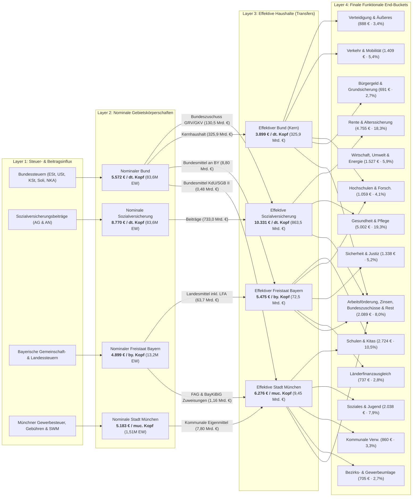

# Fiscal Per-Capita Breakdown: Bund, Freistaat Bayern & Landeshauptstadt München

[](.agents/skills/responsible-research/scripts/audit_research_pipeline.py)
[](datasets/fiscal_sankey_flows_per_capita.csv)
[](plots/sankey_fiscal_per_capita.png)
[](plots/sankey_fiscal_interactive.html)

> [!IMPORTANT]
> **Exclusive Visualization & Analytical Focus**:
> This repository is dedicated **exclusively to the 4-Layer Fiscal Per-Capita Sankey Architecture** ([`plots/sankey_fiscal_per_capita.png`](plots/sankey_fiscal_per_capita.png), [`plots/sankey_fiscal_per_capita.svg`](plots/sankey_fiscal_per_capita.svg), and interactive [`plots/sankey_fiscal_interactive.html`](plots/sankey_fiscal_interactive.html)). All empirical ETL pipelines, accounting normalizations, and visualization generators are built solely to power and audit this unified multi-level Sankey network. All auxiliary non-Sankey sub-panels and matrices have been explicitly retired.

This repository provides an empirical, publication-grade fiscal analysis decomposing public money in Germany for an individual resident of the **City of Munich (*Landeshauptstadt München*)** in 2024 (with longitudinal comparison to 2023). Every resident of Munich simultaneously receives public goods and services financed across four distinct public tiers:
1. **Federal Republic of Germany (*Bund*)**
2. **Statutory Social Insurances (*Sozialversicherungsträger*: GRV, GKV, SPV, BA, DGUV)**
3. **Free State of Bavaria (*Freistaat Bayern*)**
4. **City of Munich (*Landeshauptstadt München*)**

The flagship analytical visualization is a **4-Layer High-Resolution Sankey Diagram** ([plots/sankey_fiscal_per_capita.png](plots/sankey_fiscal_per_capita.png) and [plots/sankey_fiscal_interactive.html](plots/sankey_fiscal_interactive.html)), built using verified primary source documents from the Federal Ministry of Finance (BMF), the Federal Statistical Office (Destatis), the Bavarian State Ministry of Finance and Homeland (StMFH), and the Munich Municipal Treasury (*Stadtkämmerei München*).

---

## 1. The 4-Layer Fiscal Sankey Diagram

The Sankey diagram tracks the complete lifecycle of public funds—from primary tax and contribution origin, through gross jurisdictional appropriation and vertical/horizontal intergovernmental transfers, into final citizen-facing functional areas.

The visualization is organized into 4 distinct architectural column headers:
1. **Layer 1: Steuer- & Beitragsinflux** (Primary tax and social insurance contribution streams)
2. **Layer 2: Nominale Gebietskörperschaften** (Gross institutional appropriations prior to transfers)
3. **Layer 3: Effektive Haushalte** (Net disposable outlays after intergovernmental transfers and levies)
4. **Layer 4: Finale Funktionale End-Buckets** (19 citizen-facing destination categories, dynamically sorted descending by per-capita spending with percentage shares)

Vertical and horizontal transfers between Layer 2 and Layer 3 (such as the *Bundeszuschüsse* to pensions and health, state allocations *FAG/BayKiBiG*, and municipal levies *Bezirksumlage*) are explicitly routed as dedicated link ribbons without intermediate column clutter. The footer callouts (documenting the official Zensus 2022 population baselines and primary source registers) are positioned at the base of the canvas with clear vertical clearance below the lowest nodes.

<p align="center">
  <a href="plots/sankey_fiscal_interactive.html">
    
  </a>
  <br>
  <em>Figure 1: 4-Layer Multi-Level Fiscal Architecture (2024) for a Munich resident. Proportional ribbon widths scaled to conserved physical volume (€ bn) with citizen-facing per-capita metrics (€/Kopf). Click image to view interactive HTML version with 2024/2023 year switcher.</em>
</p>



---

## 2. Layer Taxonomy & Flow Semantics

### Layer 1: Steuer- & Beitragsinflux (Revenue Stream Influx)
Every influx node shares the color of its respective Layer 2 nominal entity and is vertically clustered directly adjacent to it:
- **Federal Taxes (Navy `#1e3a8a`)**: Lohn- und Einkommensteuer, Umsatzsteuer, Körperschaftsteuer, Verbrauchssteuern (Energie, Tabak, Kfz), Solidaritätszuschlag und Nettokreditaufnahme.
- **Social Insurance Contributions (Teal `#0d9488`)**: Pure employer and employee payroll contributions to Pension (GRV), Health (GKV), Long-Term Care (SPV), Unemployment (BA), and Occupational Accident (DGUV) insurance.
- **Bavarian Own Revenues (Bavarian Sky Blue `#0284c7`)**: Share of shared joint taxes (*Gemeinschaftsteuern*), dedicated state taxes (inheritance, real estate transfer), and administrative revenues. Federal grants (*Bundesmittel*) are routed via the Federal tier.
- **Munich Municipal Revenues (Munich Amber `#d97706`)**: Pure own municipal tax revenues and financing ($7.801\text{ Mrd. €}$ in 2024 / $7.212\text{ Mrd. €}$ in 2023): Trade tax (*Gewerbesteuer netto* $3.24\text{ Mrd. €}$), municipal share of income and VAT ($1.83\text{ Mrd. €}$), fees/rents ($1.03\text{ Mrd. €}$), municipal deficit/borrowing ($0.89\text{ Mrd. €}$), SWM public utility profit distribution ($0.45\text{ Mrd. €}$), and property tax (*Grundsteuer* $0.36\text{ Mrd. €}$). Direct federal grants ($0.483\text{ Mrd. €}$) and state allocations ($1.162\text{ Mrd. €}$) are routed via their originating sovereign tiers into Layer 3.

### Layer 2: Nominale Gebietskörperschaften (Gross Inflow Entities)
Represents the gross budgetary volume appropriated by each tier prior to intergovernmental equalizations:
- **Nominaler Bund**: **5.572 € / resident** (€465,67 bn · Basis: 83,6M EW)
- **Nominale Sozialversicherung**: **8.770 € / resident** (€732,97 bn pure contributions · Basis: 83,6M EW)
- **Nominaler Freistaat Bayern**: **4.899 € / resident** (€64,90 bn own revenues · Basis: 13,2M EW)
- **Nominale Stadt München**: **5.183 € / resident** (€7,801 bn pure own revenues & financing · Basis: 1,51M EW)

> [!IMPORTANT]
> **Strict Layer 2 Isolation**: Nodes in Layer 2 connect **exclusively to Layer 3**. All nominal gross revenues must either pass into core retention or be transferred to another tier. No nominal link bypasses Layer 3.

### Intergovernmental Transfers (Layer 2 $\to$ Layer 3)
Between Layer 2 and Layer 3, the vertical and horizontal fiscal transfers of German federalism are made explicit:
1. **Federal Subsidies to Social Insurances (*Bundeszuschüsse*)**:
   - Bund $\to$ Rentenversicherung: **1.388 € / resident** (€116,00 bn)
   - Bund $\to$ Gesundheitsfonds: **173 € / resident** (€14,50 bn)
   - *Total*: **1.561 € / resident** (€130,50 bn tax-financed subsidy styled in vibrant purple `rgba(139, 92, 246, 0.85)`).
2. **Federal Grants to Free State of Bavaria (*Bundeszuweisungen*)**:
   - Bund $\to$ Freistaat Bayern: **664 € / resident** (€8,80 bn federal co-funding for transport, education, and administration).
3. **Federal Social Reimbursements to Munich (*KdU & Grundsicherung SGB II/XII*)**:
   - Bund $\to$ Stadt München: **321 € / resident** (€0,483 bn federal statutory reimbursement for municipal accommodation costs and basic security in old age, deducted symmetrically from federal Bürgergeld outlays in Layer 4).
4. **Bavarian Gross Grants to Munich (*Kommunaler Finanzausgleich & Zuweisungen*)**:
   - Freistaat Bayern $\to$ München: **772 € / resident** (€1,162 bn total: FAG municipal allocations + BayKiBiG childcare operational subsidies).
5. **Munich Statutory Levies (*Umlagen*)**:
   - Out of its ordinary budget, Munich remits **705 € / resident** (€1,061 bn total: Gewerbesteuerumlage €0,232 bn + Bezirksumlage an den Bezirk Oberbayern €0,829 bn for integration and psychiatric welfare) routed from Layer 3 into Layer 4 as a dedicated transfer bucket `Bezirks- & Gewerbesteuerumlage (MUC)`.

### Layer 3: Effektive Haushalte (Net Effective Budgets)
The net disposable funds available to each public entity following intergovernmental consolidation:
- **Effektiver Bund (Kern)**: **3.899 € / resident** (€325,89 bn)
- **Effektive Sozialversicherung**: **10.331 € / resident** (€852,04 bn direct outlays + €11,43 bn liquidity reserve = €863,47 bn total resources)
- **Effektiver Freistaat Bayern**: **5.475 € / resident** (€72,54 bn)
- **Effektive Stadt München**: **6.276 € / resident** (€9,45 bn: €7,801 bn own revenues + €1,162 bn state grants + €0,483 bn federal reimbursements)

### Layer 4: Finale Funktionale End-Buckets (Citizen-Facing Outlays)
Final destination categories providing direct public utility, sorted strictly descending by per-capita size with percentage shares of total per-capita outlays ($25{,}960.98\text{ €/resident}$ in 2024):
1. **Gesundheit & Pflege**: **5.002 € / resident** (19,3% · €402,14 bn)
2. **Rente & Alterssicherung**: **4.755 € / resident** (18,3% · €397,40 bn)
3. **Schulen & Kitas**: **2.724 € / resident** (10,5% · €18,16 bn)
4. **Soziales, Jugend & Familie**: **2.038 € / resident** (7,9% · €24,67 bn)
5. **Wirtschaft, Umwelt & Energie**: **1.527 € / resident** (5,9% · €40,38 bn)
6. **Verkehrswege, Mobilität & ÖPNV**: **1.409 € / resident** (5,4% · €43,44 bn)
7. **Sicherheit und Justiz**: **1.338 € / resident** (5,2% · €27,37 bn)
8. **Hochschulen und Forschung**: **1.059 € / resident** (4,1% · €39,14 bn)
9. **Verteidigung und Äußeres**: **888 € / resident** (3,4% · €74,20 bn)
10. **Kommunale Verwaltung & IT (MUC)**: **860 € / resident** (3,3% · €1,29 bn)
11. **Länderfinanzausgleich (Ausgleich an andere Länder)**: **737 € / resident** (2,8% · €9,77 bn Nettoabfluss Bayern)
12. **Bezirks- & Gewerbesteuerumlage (MUC)**: **705 € / resident** (2,7% · €1,061 bn)
13. **Bürgergeld & Grundsicherung**: **691 € / resident** (2,7% · €57,78 bn net after federal transfer to Munich)
14. **Arbeitsförderung & Unfallreha**: **642 € / resident** (2,5% · €53,64 bn)
15. **Schuldendienst und Zinsen**: **409 € / resident** (1,6% · €34,22 bn)
16. **Wirtschaft, Verwaltung, Landesentwicklung & Reserve (BY)**: **408 € / resident** (1,6% · €5,41 bn)
17. **Bundeszuweisungen an andere Länder**: **297 € / resident** (1,1% · €24,80 bn)
18. **Kultur, Theater & Museen**: **189 € / resident** (0,7% · €0,28 bn)
19. **Rücklagen- & Liquiditätspuffer**: **137 € / resident** (0,5% · €11,43 bn)
20. **Wohnungsbau und Stadtentwicklung**: **123 € / resident** (0,5% · €4,19 bn)
21. **Kommunaler Finanzausgleich übrige Kommunen (BY)**: **43 € / resident** (0,2% · €0,57 bn)

> [!NOTE]
> **Mathematical Verification**: By Kirchhoff's law, every layer satisfies exact flow conservation in physical currency units:
> $$\sum \text{Layer 1} \equiv \sum \text{Layer 2} \equiv \sum \text{Layer 3} \equiv \sum \text{Layer 4} = 1{,}271.341\text{ Mrd. €} \quad (\Delta = 0.000\text{ Mrd. €})$$

---

## 3. Data Provenance & Primary Source Documentation

All primary data tables reside in [`rawdata/`](rawdata/) and are cryptographically verified against SHA-256 checksums in [`rawdata/MANIFEST.csv`](rawdata/MANIFEST.csv). Verified official source documents reside in [`literature/`](literature/):

| Primary Source Document (PDF) | File Size | Originating Institution | Official Deep Link |
| :--- | :--- | :--- | :--- |
| `BMF_2025_Vorlaeufiger_Abschluss_Bundeshaushalt_2024.pdf` | 572 KB | Bundesministerium der Finanzen (BMF) | [bundesfinanzministerium.de](https://www.bundesfinanzministerium.de) |
| `BMF_2025_Steuereinnahmen_Dezember_2024.pdf` | 363 KB | Bundesministerium der Finanzen (BMF) | [bundesfinanzministerium.de](https://www.bundesfinanzministerium.de) |
| `BMAS_2024_Sozialbudget_2023.pdf` | 965 KB | Bundesministerium für Arbeit und Soziales (BMAS) | [bmas.de](https://www.bmas.de) |
| `Muenchen_2024_Haushaltsplan_Band_1_Gesamthaushalt.pdf` | 5.8 MB | Landeshauptstadt München Stadtkämmerei | [muenchen.de](https://stadt.muenchen.de) |
| `Bayern_GVBl_2024_Haushaltsgesetz_2024_2025.pdf` | 277 KB | Bayerischer Landtag / StMFH | [verkuendung-bayern.de](https://www.verkuendung-bayern.de) |
| `Destatis_2024_Qualitaetsbericht_Zensus_2022.pdf` | 681 KB | Statistisches Bundesamt (Destatis) | [destatis.de](https://www.destatis.de) |

### Demographic Denominators (Zensus 2022 Tier 1 Baseline)
Normalizations use official post-censal populations (*Amtliche Einwohnerzahl fortgeschrieben auf Basis Zensus 2022*):
- **Deutschland**: $83.577.140$ residents (2024) / $83.456.045$ residents (2023)
- **Freistaat Bayern**: $13.248.928$ residents (2024) / $13.176.426$ residents (2023)
- **Landeshauptstadt München**: $1.505.005$ residents (2024) / $1.488.719$ residents (2023)

---

## 4. Quickstart & Pipeline Reproduction

### Prerequisites
- Python 3.9+
- macOS / Linux / Windows

### Setup Environment
```bash
# 1. Clone repository
git clone https://github.com/visualDemographics/DE-fiscal-per-capita.git
cd DE-fiscal-per-capita

# 2. Initialize virtual environment and install dependencies
python3 -m venv .venv
source .venv/bin/activate
pip install -r requirements.txt
```

### Execute Data Pipeline & Rendering
```bash
# 3. Process raw administrative tables and generate audited flows
.venv/bin/python3 src/data_preparation.py

# 4. Render high-resolution Sankey (PNG, SVG, and interactive HTML)
.venv/bin/python3 src/modeling.py

# 5. Run the automated research pipeline audit
.venv/bin/python3 .agents/skills/responsible-research/scripts/audit_research_pipeline.py
```

Expected audit output:
```
======================================================================
RESPONSIBLE RESEARCH: GENERAL PIPELINE AUDIT SUITE
======================================================================
[Check 1] Validating Repository Directory Structure & Environment Pinning...   ✓ PASSED
[Check 2] Validating Rawdata Manifest & Cryptographic SHA-256 Provenance...     ✓ PASSED
[Check 3] Validating Active Datasets & Quarantine Hygiene in datasets/...       ✓ PASSED
[Check 4] Running Strict AST Static Code Analysis on src/*.py...               ✓ PASSED
[Check 5] Verifying Plot Validity Documentation (plots/plot.md)...             ✓ PASSED
[Check 6] Verifying Primary Source Literature PDFs in literature/...           ✓ PASSED
[Check 7] Verifying Residual & Unallocated Budget Shares (< 5% Cap)...         ✓ PASSED
[Check 8] Verifying Falsifiable Hypotheses Closure (H1-H4 Verdicts)...         ✓ PASSED
[Check 9] Verifying Primary Source PDF Veracity of Literature Benchmarks...    ✓ PASSED
======================================================================
PIPELINE AUDIT COMPLETE: 9/9 CHECKS PASSED.
======================================================================
```

---

## 5. Repository Structure

```
DE-fiscal-per-capita/
├── README.md                                      # Central repository documentation (this file)
├── AGENTS.md                                      # Visual artifact and plotting invariants
├── styling_guide.md                               # Flagship styling & aesthetics design system
├── requirements.txt                               # Pinned dependencies (plotly, kaleido, pandas, etc.)
├── rawdata/                                       # Immutable primary source registers
│   ├── MANIFEST.csv                               # Cryptographic SHA-256 registry
│   ├── rawdata.md                                 # Provenance descriptions & register citations
│   ├── destatis_bundeshaushalt_2023_2024.csv
│   ├── destatis_sozialversicherung_2023_2024.csv
│   ├── bayern_staatshaushalt_2023_2024.csv
│   ├── muenchen_haushalt_2023_2024.csv
│   ├── demographics_zensus_denominators_2023_2024.csv
│   └── literature_empirical_benchmarks.csv
├── datasets/                                      # Audited analysis-ready datasets
│   ├── datasets.md                                # Variable codebook and mathematical definitions
│   ├── fiscal_sankey_flows_per_capita.csv         # 126 directed graph edges with €/Kopf & € bn
│   ├── fiscal_per_capita_summary.csv              # Headline comparative summary across tiers
│   ├── fiscal_transfer_consolidation_ledger.csv   # Intergovernmental transfer reconciliations
│   ├── functional_crosswalk.csv                   # Functional destination mappings
│   └── literature_empirical_benchmarks.csv        # Verbatim literature citations and benchmark catalog
├── plots/                                         # Flagship publication figures (Exclusive Sankey Focus)
│   ├── plot.md                                    # Systematic methodological plot documentation
│   ├── styling_guide.md                           # Complete visual specification & color palette
│   ├── sankey_fiscal_per_capita.png               # High-res static Sankey (5200x4500 px)
│   ├── sankey_fiscal_per_capita.svg               # Scalable Vector Graphics master export
│   └── sankey_fiscal_interactive.html             # Interactive Plotly web widget with year switch
├── src/                                           # Audited pipeline source code (AST compliant)
│   ├── data_preparation.py                        # Raw-to-dataset normalization & flow builder
│   └── modeling.py                                # Plotly/Kaleido Sankey rendering engine
├── literature/                                    # Academic and administrative citations catalog
│   ├── BMF_2025_Vorlaeufiger_Abschluss_Bundeshaushalt_2024.pdf
│   ├── BMF_2025_Steuereinnahmen_Dezember_2024.pdf
│   ├── BMAS_2024_Sozialbudget_2023.pdf
│   ├── Bayern_GVBl_2024_Haushaltsgesetz_2024_2025.pdf
│   ├── Destatis_2024_Bevoelkerungsstand_12411.pdf
│   ├── Destatis_2024_Gemeindesteuern_Kassenstatistik.pdf
│   ├── Destatis_2024_Qualitaetsbericht_Zensus_2022.pdf
│   ├── Destatis_2024_Statement_Zensus_2022.pdf
│   ├── Destatis_2025_Finanzkraftausgleich_2024.pdf
│   ├── LfStat_2024_Statistik_Kommunal_Muenchen_09162.pdf
│   ├── Muenchen_2024_Haushaltsplan_Band_1_Gesamthaushalt.pdf
│   ├── literature.md                              # Complete bibliographic index
│   └── citations.md                               # Page/table extraction quotes
└── goal/
    ├── description.md                             # Research scope and goals
    └── hypothesis.md                              # Falsifiable hypotheses & closed verdicts
```

---

## 6. Citation & Legal Notice

Primary administrative data are public sector information (*Amtliche Werke*) under § 5 UrhG (Germany). All rights reserved for repository synthesis, modeling architectures, and visualization assets.

If you reference this model or visualization in research, policy analysis, or journalism, please cite:

```bibtex
@misc{fiscal_per_capita_munich_2024,
  author       = {visualDemographics, Antigravity Empirical Research Team},
  title        = {4-Layer Fiscal Per-Capita Breakdown: Bund, Freistaat Bayern & Landeshauptstadt München},
  year         = {2024},
  publisher    = {GitHub},
  howpublished = {\url{https://github.com/visualDemographics/DE-fiscal-per-capita}}
}
```
